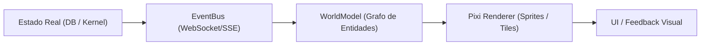
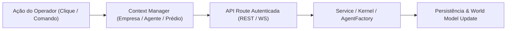
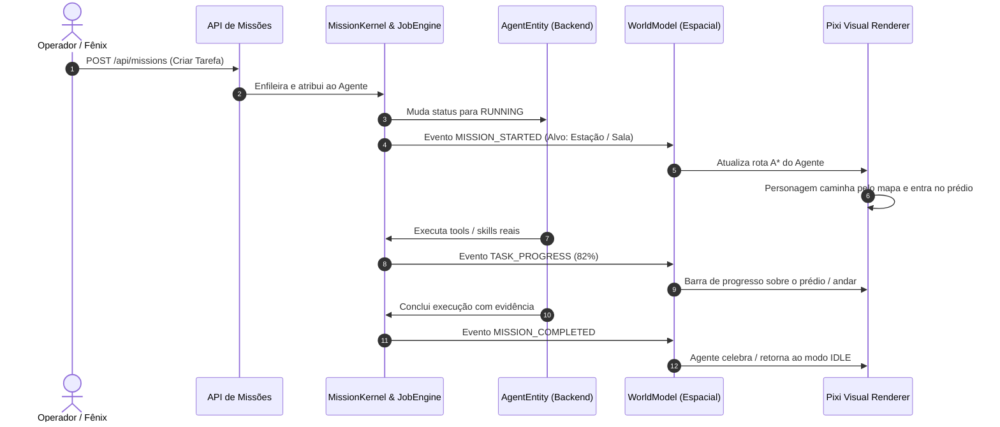

# FÊNIX OS — CITY REALITY ENGINE
## PRINCÍPIOS FUNDAMENTAIS & CONSTITUIÇÃO DA REALIDADE ESPACIAL

> **CONSTITUIÇÃO DA REALIDADE ESPACIAL DO FÊNIX OS**
> "A cidade não é decoração. A cidade É o sistema operacional."
> Todo edifício, andar, sala, mesa, personagem, veículo, via e conexão que aparece na tela do Fênix OS é o reflexo direto e mensurável de uma entidade de software viva.

---

## 1. O Princípio da Reciprocidade Causal Bidirecional

No Fênix OS, o mundo visual e o plano de controle operam em sincronia contínua através de dois fluxos causais invioláveis:

### 1.1 Fluxo Observável: `ESTADO REAL ➔ MUNDO VISUAL`

1. Uma alteração ocorre no runtime (ex.: novo job é agendado, agente conclui task, servidor registra erro).
2. O evento correspondente é emitido no barramento central.
3. O `WorldModel` atualiza suas coordenadas, ocupações e nós de relacionamento.
4. O motor visual de alta densidade reflete a mudança no frame subsequente (60 FPS).
5. O operador vê o agente se movimentar, o prédio mudar de cor ou o feixe de partículas de deploy atravessar a cidade.

### 1.2 Fluxo Acionável: `AÇÃO DO OPERADOR ➔ ESTADO REAL`

1. O operador clica no botão "Criar Agente", seleciona a empresa "Depósito Mais", ou clica em uma sala de reunião.
2. O contexto da UI atualiza e despacha a requisição formal para a API canônica com token de sessão.
3. O serviço de backend valida permissões, aloca recursos e persiste no banco relacional/store.
4. A entidade recém-criada é materializada com ID canônico, atributos reais e presença física no World Model.

---

## 2. Invariantes de Honestidade e Zero-Mock

1. **Proibição Absoluta de Contagens Fabricadas**:
   - Se o `AgentRegistry` possui 8 agentes cadastrados, a interface exibirá exatamente 8.
   - Se nenhuma missão estiver ativa, a lista de missões exibirá o estado honesto vazio ou `—`.
2. **Proibição de Falso Progresso**:
   - Barras de progresso e checklists em missões refletem os steps do `MissionKernel` e status do `JobEngine` (`RUNNING`, `SUCCESS`, `FAILED`).
   - Não são permitidos `setInterval` cosméticos simulando tarefas que não existem.
3. **Telemetria de Infraestrutura Real**:
   - Métricas de CPU, memória RAM, disco e tráfego de rede na barra inferior originam-se do probe `/api/v2/system/health`, consultando o SO via `process.memoryUsage()`, `os.cpus()` e `os.loadavg()`.
4. **Persistência Auditável**:
   - Cada criação de empresa, agente ou tarefa sobrevive ao reinício do processo ou reload do navegador.

---

## 3. As Três Dimensões Coexistentes do Sistema

| Dimensão | Metáfora | Papel no Fênix OS | Componentes Principais |
| :--- | :--- | :--- | :--- |
| **Cidade** | **O Corpo** | Representação espacial do ecossistema, geografia dos distritos, fachadas de empresas, andares internos e estações de trabalho físicas. | `pixi-city-renderer.js`, `iso-city.js`, `pixi-building-interior.js`, `CANONICAL_DISTRICTS` |
| **Cognição** | **O Cérebro / Sistema Nervoso** | Grafo topológico holográfico ligando agentes, memórias, ferramentas, modelos, skills, planos e barramento de comunicação. | `universal-system-model.js`, `graph-brain.js`, `PatternLibrary`, `NetworkView` |
| **Operação** | **As Mãos** | Execução prática de engenharia: workspaces de código, IDE visual, terminal SSH/Powershell, automação de navegador e pipelines CI/CD. | `project-ide-live.js`, `dev-pipeline-client.js`, `ProjectKernel`, `Docker/PM2` |

---

## 4. O Ciclo de Vida da Ação de um Agente no Mundo

