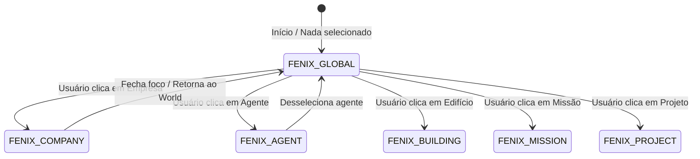

# FÊNIX OS — CONTEXTUAL UI & COMMAND CENTER
## ARQUITETURA DA INTERFACE CONTEXTUAL & PAINEL DO FÊNIX

> **ESPECIFICAÇÃO DE UI & EXPERIÊNCIA DO OPERADOR**
> O painel do Fênix OS não é um chat fixo: ele é um Centro de Comando Contextual Reativo que se transforma dependendo do que o usuário observa ou seleciona.

---

## 1. Modos de Operação do Painel Direito

### 1.1 Fênix Global
- Exibido quando a cidade inteira está no campo de visão sem elemento focado.
- Conteúdo: Saudação ao operador, 4 atalhos mestres (`Criar Agente`, `Nova Missão`, `Abrir Projeto`, `Iniciar Reunião`), sugestões proativas baseadas na saúde do sistema e backlog de tarefas.

### 1.2 Fênix + Empresa (Company Inspector)
- Ativado ao selecionar uma empresa na lista lateral ou clicar no seu prédio.
- Ilustração hero da empresa (galpão, fachada, docas).
- Metadados cadastrais reais: razão social, localização, fundação, resumo.
- 6 KPIs de topo factuais (Agentes, Missões, Projetos, Operações, Performance, Faturamento).
- Diagnóstico do Fênix com oportunidades de melhoria sugeridas.
- Ações imediatas: `[ Ver Análise Completa ]`, `[ Criar Missão ]`, `[ Abrir Projeto ]`, `[ Criar Agente ]`.
- Chat com atalhos contextuais: "Resumo da empresa", "Criar missão", "Analisar vendas", "Propor melhorias".

### 1.3 Fênix + Agente (Agent Inspector & Holographic Brain)
- Avatar pixel art do agente animado, status real (`Trabalhando`, `Disponível`, `Em reunião`).
- Matriz de habilidades (`skills`), ferramentas (`tools`) e memória episódica associada.
- Localização física no mundo: Distrito, Prédio, Andar e Mesa.
- Missão em execução atual com barra de progresso.
- Botão para alternar para a **Network View (Rede Cognitiva)** com foco nas conexões daquele agente.

### 1.4 Fênix + Prédio (Cutaway de Andar)
- Seletor de andares (`Cobertura`, `Andar 3`, `Andar 2`, `Andar 1`, `Térreo`, `Subsolo`).
- Lista de salas com contagem de agentes presentes em tempo real.
- Botão `[ Teletransportar para andar ]` e inspeção de recursos da infraestrutura predial.

---

## 2. Dock Modular Inferior (`#fenixModularBottomDock`)

O rodapé da tela abriga um dock flexível composto por até 4 cartões operacionais simultâneos:

1. **Mapa Global**: Visão macro da cidade com toggles de camadas (`Distritos`, `Prédios`, `Agentes`, `Missões`, `Eventos`).
2. **Grade de Agentes**: Mini-avatares com crachá de identificação e filtro por status operacional.
3. **Cutaway Interno de Edifício**: Visualização detalhada do andar selecionado com estações de trabalho e reuniões.
4. **Fila de Missões & Detalhes**: Lista com barra de progresso de cada missão e checklist dos 5 estágios (Planejamento, Desenvolvimento, Testes, Revisão, Deploy).
