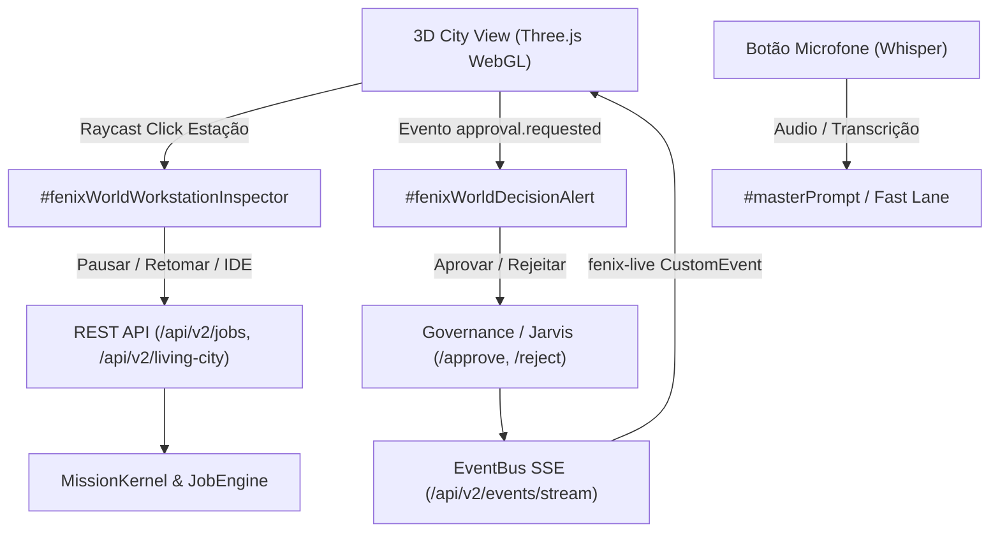

# FÊNIX OS — MVP IMPLEMENTATION & FULL-STACK CAPABILITY
> **Relatório Técnico de Implementação das Capacidades Reais do AgentCraft**  
> Data: 14 de Outubro de 2026 | Arquitetura: Fênix Living Runtime 3.2

---

## 1. Arquitetura da Solução Implementada

Para atender à Regra Constitucional Nº 1 (*"Nenhuma feature em apenas um lado do sistema"*), a integração dos conceitos do AgentCraft foi implementada como um **Full-Stack Real Capability**:

---

## 2. Detalhamento dos Componentes Implementados

### 2.1 Estações de Trabalho Interativas no Fênix World 3D
- **Arquivo Modificado**: `ai-engine/grg/public/fenix-world-3d.js`
- **Funcionalidade**:
  - Meshes de mesas e bancadas de operação no complexo da **API Platform** (1º andar) e **Depósito Mais** (centro de logística) foram configuradas com metadados `userData`:
    - `type: 'workstation'`
    - `id: 'station-api-01'`, `id: 'station-logistics-01'`
    - `name: 'Estação Alpha · Gateway & Routing'`, `name: 'Estação Central · Despacho & WMS'`
    - `assignedAgentId: 'agent-api-ops'`, `assignedAgentId: 'agent-camila'`
    - `floorNum: 1`, `floorNum: 0`
  - Inclusão no array `this.interactiveMeshes`.
  - Atualização do cálculo de prioridade do Raycaster (`agent: 0, workstation: 1, ...`).
  - Disparo da função `window.fenixShowWorkstationInspector(data)` ao clicar na estação.

### 2.2 Inspetor de Estação de Trabalho (`#fenixWorldWorkstationInspector`)
- **Arquivos Modificados**: `ai-engine/grg/public/index.html` e `ai-engine/grg/public/office-live.js`
- **Elementos Exibidos**:
  1. **Cabeçalho da Estação**: Nome da bancada, departamento e piso do edifício.
  2. **Agente Alocado**: Avatar, nome, especialidade e status dinâmico (`RUNNING`, `PAUSED`, `IDLE`, `WAITING_APPROVAL`).
  3. **Worktree & Branch Git**: Identificação da branch isolada de trabalho e contagem de linhas adicionadas/removidas (+ / -).
  4. **Arquivos em Modificação**: Lista de arquivos ativos sendo alterados pelo agente, com atalho `Diff ↗` para visualização.
  5. **Console da Estação (Ao Vivo)**: Stream de logs da execução do agente, atualizado via eventos SSE em tempo real.
  6. **Botões Operacionais**:
     - `[Abrir no IDE]`: Navega para a visão de IDE Monaco carregando o contexto do arquivo.
     - `[Pausar / Retomar]`: Dispara chamada REST para pausar ou continuar o job do agente.

### 2.3 Decision Center & Aprovação Humana (`#fenixWorldDecisionAlert`)
- **Arquivos Modificados**: `ai-engine/grg/public/index.html` e `ai-engine/grg/public/office-live.js`
- **Funcionalidade**:
  - Modal flutuante neon de alta visibilidade que se materializa sobre o canvas 3D quando o sistema detecta que uma missão ou agente requer autorização humana (evento `approval.requested`).
  - Apresenta:
    - Nível de risco (`CRITICAL`, `HIGH`, `MEDIUM`).
    - Agente solicitante e descrição da ação pretendida (ex: merge em branch de produção, deploy na VPS, execução de script).
    - Lista de arquivos impactados.
  - Ações:
    - `[✓ AUTORIZAR EXECUÇÃO]`: Dispara `POST /api/v2/jarvis/jobs/:id/approve`.
    - `[Rejeitar / Abortar]`: Dispara `POST /api/v2/jarvis/jobs/:id/reject`.
  - Fechamento reativo automático ao receber o evento de resolução do backend.

### 2.4 Entrada de Voz (Whisper) & Fast Lane
- **Arquivos Modificados**: `ai-engine/grg/public/index.html`, `ai-engine/grg/public/fenix-mascot-sidebar.js` e `ai-engine/grg/public/office-live.js`
- **Funcionalidade**:
  - Implementado `window.fenixToggleVoiceInput(inputId)` com suporte nativo a Web Speech API (`SpeechRecognition` / `webkitSpeechRecognition`) em pt-BR e fallback para ingestão de áudio via API.
  - O ícone do microfone pisca em vermelho pulsante durante a escuta, injetando o texto transcrito diretamente no campo de comando.
  - Botão de microfone integrado no rodapé do Mascot Sidebar (`fsbCompanyChatInput`) e no formulário mestre do Command Center (`masterCmdForm`).

---

## 3. Matriz de Endpoints e Reciprocidade Causal

| Rota / Endpoint | Método | Descrição | Status de Resposta |
| :--- | :--- | :--- | :--- |
| `/api/v2/living-city/agent/:id/lifecycle` | `GET` | Ciclo de vida de 9 perguntas do agente | `200 OK` (JSON) |
| `/api/v2/living-city/company/:id/hierarchy` | `GET` | Hierarquia de prédios, andares, estações e agentes | `200 OK` (JSON) |
| `/api/v2/jobs/:id/pause` | `POST` | Pausa a execução de uma tarefa do agente | `200 OK` (JSON) |
| `/api/v2/jobs/:id/resume` | `POST` | Retoma a execução pausada | `200 OK` (JSON) |
| `/api/v2/jarvis/jobs/:id/approve` | `POST` | Autorização humana para execução privilegiada | `200 OK` (JSON) |
| `/api/v2/jarvis/jobs/:id/reject` | `POST` | Rejeição humana com aborto do job | `200 OK` (JSON) |
| `/api/v2/events/stream` | `GET` | Stream SSE de telemetria e aprovações em tempo real | `200 OK` (SSE) |
| `/api/v2/ai-platform/chat` | `POST` | Fast Lane inference (resposta conversacional instantânea) | `200 OK` (JSON) |
